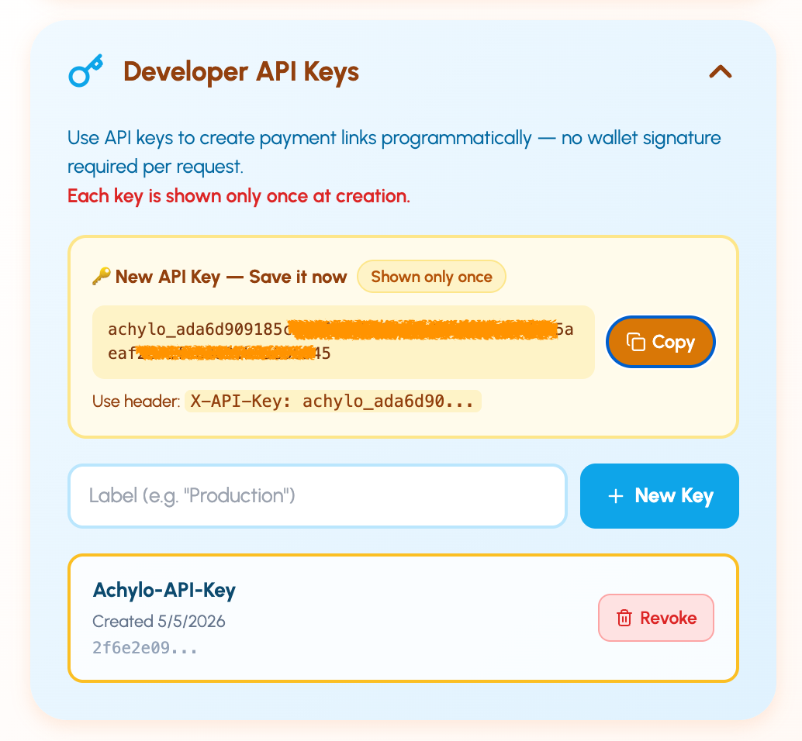

# API Keys

API Keys let your servers call the Achylo API without a wallet signature on every request. They are the recommended auth method for programmatic integrations.

## Base URL

```
https://api.achylo.com
```

All paths below are relative to that host. Pass the key on every request:

```http
X-API-Key: achylo_<your_key>
```

```bash
export BASE='https://api.achylo.com'
export ACHYLO_API_KEY='achylo_…'
```

---

## Key format

```
achylo_<64 hex characters>
```

Example:

```
achylo_a3f2c8b9d4e1f6a7c2b8d9e3f1a4c7b2a3f2c8b9d4e1f6a7c2b8d9e3f1a4c7b2
```

## Limits

- **Maximum 10 active keys** per account
- Keys do not expire automatically — revoke them when no longer needed

## Managing keys via the Dashboard

1. Go to [achylo.com](https://achylo.com) and connect your wallet
2. Open **User Profile** (top right)
3. Scroll to **Developer API Keys**
4. Enter an optional label (e.g. `"Production"`, `"Staging"`)
5. Click **New Key** — the key is displayed **once only**

<p align="center">
  
</p>

<p align="center"><strong>Img. No.1. API Key.</strong></p>

---

## What an API Key can access

With **only** `X-API-Key` (no JWT), your backend can call the endpoints below. Wallet-session routes (manage keys, create agents, receipts, push, Graph proxy, etc.) stay **JWT-only** and are omitted here.

### Auth rules

| Key type | Reads (scoped) | Writes (scoped) | Products / Widgets |
|----------|----------------|-----------------|--------------------|
| **Unbound** (legacy, no agent) | Allowed for all read scopes | Denied (`SCOPE_DENIED`) | Allowed (no agent scope check) |
| **Bound** to an API Agent | Only scopes toggled on the agent | Only write scopes toggled + Forwarder for P2P | Allowed (acts as the key owner) |

Amounts on Payment Links / P2P may also hit agent policy (`maxAmountUsdc` / `dailyCapUsdc`).

### Scope catalog

| Scope | Needed for |
|-------|------------|
| `payment_links:read` | List / (optional) get payment links |
| `payment_links:write` | Create / cancel payment links |
| `oracle:read` | Price oracle |
| `fiat:read` | Fiat currencies |
| `wallet:balance` | USDC balance |
| `p2p:orders:read` | Public P2P order book |
| `automation:config` | Automation config (when key present) |
| `automation:permissions` | Forwarder permission status |
| `automation:payment_methods` | Saved payment methods |
| `automation:operations` | Poll async operations |
| `p2p:create` / `accept` / `confirm` / `cancel` / `dispute` / `update` | P2P order writes |
| `p2p:release` / `p2p:reclaim` | Escrow release / reclaim |

List scopes from the API:

```bash
curl -sS "$BASE/api/v1/agents/scopes" \
  -H "X-API-Key: $ACHYLO_API_KEY"
```

Full agent + Forwarder setup: [Achylo MCP](/developers/mcp).

---

## Endpoint map (API Key)

### Payment Links

| Method | Path | Scope (if key bound) |
|--------|------|----------------------|
| `POST` | `/api/payment-links` | `payment_links:write` |
| `GET` | `/api/payment-links/history` | `payment_links:read` |
| `GET` | `/api/payment-links/:id` | public; if key sent → `payment_links:read` |
| `DELETE` | `/api/payment-links/:id` | `payment_links:write` |

### Products (Widgets V2)

| Method | Path | Notes |
|--------|------|-------|
| `POST` | `/api/v1/products` | Create |
| `GET` | `/api/v1/products` | List |
| `GET` | `/api/v1/products/:id` | Get |
| `PUT` | `/api/v1/products/:id` | Update |
| `DELETE` | `/api/v1/products/:id` | Soft-delete |

### Widgets V2

| Method | Path | Notes |
|--------|------|-------|
| `POST` | `/api/v1/widgets/bundle` | Product + widget in one call |
| `POST` | `/api/v1/widgets` | Create widget |
| `GET` | `/api/v1/widgets` | List |
| `GET` | `/api/v1/widgets/:id` | Get |
| `PUT` | `/api/v1/widgets/:id` | Update |
| `DELETE` | `/api/v1/widgets/:id` | Delete |

### Widgets V1 (legacy merchants)

| Method | Path |
|--------|------|
| `POST` | `/api/widget-merchants` |
| `GET` | `/api/widget-merchants` |
| `PATCH` | `/api/widget-merchants/:merchantId` |
| `DELETE` | `/api/widget-merchants/:merchantId` |

### Market / wallet reads

| Method | Path | Scope |
|--------|------|-------|
| `GET` | `/api/v1/market/fiat-currencies` | `fiat:read` |
| `GET` | `/api/v1/market/oracle/:currencyId` | `oracle:read` |
| `GET` | `/api/v1/wallet/usdc-balance?address=0x…` | `wallet:balance` |
| `GET` | `/api/v1/p2p/public-orders` | `p2p:orders:read` |

### Automation / P2P (agent + Forwarder for writes)

| Method | Path | Scope |
|--------|------|-------|
| `GET` | `/api/v1/automation/config` | `automation:config` when key sent |
| `GET` | `/api/v1/automation/permissions` | `automation:permissions` |
| `GET` | `/api/v1/automation/payment-methods` | `automation:payment_methods` |
| `GET` | `/api/v1/automation/operations/:id` | `automation:operations` |
| `POST` | `/api/v1/automation/orders` | `p2p:create` |
| `POST` | `/api/v1/automation/orders/:id/accept` | `p2p:accept` |
| `POST` | `/api/v1/automation/orders/:id/confirm-payment` | `p2p:confirm` |
| `POST` | `/api/v1/automation/orders/:id/cancel` | `p2p:cancel` |
| `POST` | `/api/v1/automation/orders/:id/dispute` | `p2p:dispute` |
| `PATCH` | `/api/v1/automation/orders/:id` | `p2p:update` |
| `POST` | `/api/v1/automation/escrows/:id/release` | `p2p:release` |
| `POST` | `/api/v1/automation/escrows/:id/reclaim` | `p2p:reclaim` |

Writes **require** API Key or OAuth (JWT alone is rejected), `Idempotency-Key`, and on-chain Forwarder grants. See [MCP → Automation REST](/developers/mcp#automation-rest-same-scopes-forwarder).

### MCP

| Method | Path | Notes |
|--------|------|-------|
| `POST` / `GET` / `DELETE` | `/mcp` | Streamable HTTP; same key + scopes |

### Other

| Method | Path | Notes |
|--------|------|-------|
| `GET` | `/api/v1/agents/scopes` | Scope catalog |
| `GET` | `/api/payment-invoices/merchant/:merchantAddress` | List invoices for that merchant (must be the key owner) |

---

## Curl examples

### 1. Payment Links

```bash
# Create
curl -sS -X POST "$BASE/api/payment-links" \
  -H "X-API-Key: $ACHYLO_API_KEY" \
  -H "Content-Type: application/json" \
  -d '{
    "amount": "10000000",
    "receiver": "0xYOUR_WALLET_ADDRESS",
    "description": "Order #1234",
    "expiresInMinutes": 1440,
    "webhookUrl": "https://yoursite.com/webhooks/achylo",
    "webhookSecret": "your32to64hexcharsecret"
  }'

# History
curl -sS "$BASE/api/payment-links/history?limit=50&offset=0" \
  -H "X-API-Key: $ACHYLO_API_KEY"

# Get one (public; key optional)
curl -sS "$BASE/api/payment-links/PAYMENT_LINK_UUID" \
  -H "X-API-Key: $ACHYLO_API_KEY"

# Cancel pending
curl -sS -X DELETE "$BASE/api/payment-links/PAYMENT_LINK_UUID" \
  -H "X-API-Key: $ACHYLO_API_KEY"
```

`amount` is **micro-USDC** (`1000000` = 1 USDC). `expiresInMinutes`: `15`, `60`, `360`, `720`, or `1440`.

### 2. Products

```bash
# Create
curl -sS -X POST "$BASE/api/v1/products" \
  -H "X-API-Key: $ACHYLO_API_KEY" \
  -H "Content-Type: application/json" \
  -d '{
    "name": "Monthly Subscription",
    "description": "Full platform access",
    "amount": "29.99",
    "currency": "USDC",
    "allowCustomAmount": false,
    "billingInterval": "monthly"
  }'

# List
curl -sS "$BASE/api/v1/products" \
  -H "X-API-Key: $ACHYLO_API_KEY"

# Get
curl -sS "$BASE/api/v1/products/prod_abc12345" \
  -H "X-API-Key: $ACHYLO_API_KEY"

# Update
curl -sS -X PUT "$BASE/api/v1/products/prod_abc12345" \
  -H "X-API-Key: $ACHYLO_API_KEY" \
  -H "Content-Type: application/json" \
  -d '{
    "name": "Monthly Subscription",
    "description": "Updated",
    "amount": "34.99",
    "currency": "USDC",
    "allowCustomAmount": false,
    "billingInterval": "monthly"
  }'

# Delete
curl -sS -X DELETE "$BASE/api/v1/products/prod_abc12345" \
  -H "X-API-Key: $ACHYLO_API_KEY"
```

### 3. Widgets V2

```bash
# Bundle: product + widget
curl -sS -X POST "$BASE/api/v1/widgets/bundle" \
  -H "X-API-Key: $ACHYLO_API_KEY" \
  -H "Content-Type: application/json" \
  -d '{
    "resourceType": "product",
    "productDetails": {
      "name": "Monthly Subscription",
      "description": "Full access",
      "amount": "29.99",
      "allowCustomAmount": false
    },
    "originWhitelist": ["https://yourstore.com"],
    "payoutAddress": "0xYOUR_WALLET_ADDRESS",
    "webhookUrl": "https://yoursite.com/webhooks/achylo"
  }'

# Create widget on existing product
curl -sS -X POST "$BASE/api/v1/widgets" \
  -H "X-API-Key: $ACHYLO_API_KEY" \
  -H "Content-Type: application/json" \
  -d '{
    "resourceType": "product",
    "resourceId": "prod_abc12345",
    "originWhitelist": ["https://yourstore.com"],
    "payoutAddress": "0xYOUR_WALLET_ADDRESS"
  }'

# List / get / update / delete
curl -sS "$BASE/api/v1/widgets" \
  -H "X-API-Key: $ACHYLO_API_KEY"

curl -sS "$BASE/api/v1/widgets/wgt_def67890" \
  -H "X-API-Key: $ACHYLO_API_KEY"

curl -sS -X PUT "$BASE/api/v1/widgets/wgt_def67890" \
  -H "X-API-Key: $ACHYLO_API_KEY" \
  -H "Content-Type: application/json" \
  -d '{
    "originWhitelist": ["https://yourstore.com", "https://www.yourstore.com"]
  }'

curl -sS -X DELETE "$BASE/api/v1/widgets/wgt_def67890" \
  -H "X-API-Key: $ACHYLO_API_KEY"
```

### 4. Widgets V1 (legacy)

```bash
curl -sS -X POST "$BASE/api/widget-merchants" \
  -H "X-API-Key: $ACHYLO_API_KEY" \
  -H "Content-Type: application/json" \
  -d '{
    "origins": ["https://yourstore.com"],
    "payoutAddress": "0xYOUR_WALLET_ADDRESS",
    "webhookUrl": "https://yoursite.com/webhooks/achylo"
  }'

curl -sS "$BASE/api/widget-merchants" \
  -H "X-API-Key: $ACHYLO_API_KEY"

curl -sS -X PATCH "$BASE/api/widget-merchants/achylo_a1b2c3d4" \
  -H "X-API-Key: $ACHYLO_API_KEY" \
  -H "Content-Type: application/json" \
  -d '{ "origins": ["https://yourstore.com", "https://newdomain.com"] }'

curl -sS -X DELETE "$BASE/api/widget-merchants/achylo_a1b2c3d4" \
  -H "X-API-Key: $ACHYLO_API_KEY"
```

### 5. Market / wallet reads

```bash
curl -sS "$BASE/api/v1/market/fiat-currencies" \
  -H "X-API-Key: $ACHYLO_API_KEY"

curl -sS "$BASE/api/v1/market/oracle/0" \
  -H "X-API-Key: $ACHYLO_API_KEY"

curl -sS "$BASE/api/v1/wallet/usdc-balance?address=0xYOUR_SMART_ACCOUNT" \
  -H "X-API-Key: $ACHYLO_API_KEY"

curl -sS "$BASE/api/v1/p2p/public-orders?limit=20&offset=0" \
  -H "X-API-Key: $ACHYLO_API_KEY"
```

### 6. Automation reads

```bash
curl -sS "$BASE/api/v1/automation/config" \
  -H "X-API-Key: $ACHYLO_API_KEY"

curl -sS "$BASE/api/v1/automation/permissions" \
  -H "X-API-Key: $ACHYLO_API_KEY"

curl -sS "$BASE/api/v1/automation/payment-methods?active=true" \
  -H "X-API-Key: $ACHYLO_API_KEY"

curl -sS "$BASE/api/v1/automation/operations/OPERATION_UUID" \
  -H "X-API-Key: $ACHYLO_API_KEY"
```

Bind `smart_account_address` on the key (dashboard) or pass `?user=0x…` for permissions / payment-methods.

### 7. Automation writes (P2P)

Require bound agent scopes + Forwarder grants. Same `Idempotency-Key` must not be reused with different bodies.

```bash
# Create public order
curl -sS -X POST "$BASE/api/v1/automation/orders" \
  -H "X-API-Key: $ACHYLO_API_KEY" \
  -H "Idempotency-Key: create-order-001" \
  -H "Content-Type: application/json" \
  -d '{
    "orderType": "Sell",
    "fiatCurrency": 0,
    "exchangeRate": "1000000",
    "minAmount": "1000000",
    "maxAmount": "100000000",
    "totalAmount": "50000000",
    "customReclaimTimeout": 0,
    "merchantOnly": false,
    "paymentMethodIds": ["0xYOUR_SAVED_PAYMENT_METHOD_ID"]
  }'

# Accept
curl -sS -X POST "$BASE/api/v1/automation/orders/0xORDER_ID/accept" \
  -H "X-API-Key: $ACHYLO_API_KEY" \
  -H "Idempotency-Key: accept-001" \
  -H "Content-Type: application/json" \
  -d '{
    "amount": "10000000",
    "takerPaymentMethodId": "0xYOUR_SAVED_PAYMENT_METHOD_ID"
  }'

# Confirm / cancel / dispute
curl -sS -X POST "$BASE/api/v1/automation/orders/0xORDER_ID/confirm-payment" \
  -H "X-API-Key: $ACHYLO_API_KEY" \
  -H "Idempotency-Key: confirm-001" \
  -H "Content-Type: application/json" \
  -d '{}'

curl -sS -X POST "$BASE/api/v1/automation/orders/0xORDER_ID/cancel" \
  -H "X-API-Key: $ACHYLO_API_KEY" \
  -H "Idempotency-Key: cancel-001" \
  -H "Content-Type: application/json" \
  -d '{}'

curl -sS -X POST "$BASE/api/v1/automation/orders/0xORDER_ID/dispute" \
  -H "X-API-Key: $ACHYLO_API_KEY" \
  -H "Idempotency-Key: dispute-001" \
  -H "Content-Type: application/json" \
  -d '{}'

# Update order
curl -sS -X PATCH "$BASE/api/v1/automation/orders/0xORDER_ID" \
  -H "X-API-Key: $ACHYLO_API_KEY" \
  -H "Idempotency-Key: update-001" \
  -H "Content-Type: application/json" \
  -d '{
    "orderType": "Sell",
    "fiatCurrency": 0,
    "exchangeRate": "1100000",
    "minAmount": "1000000",
    "maxAmount": "80000000",
    "totalAmount": "40000000",
    "customReclaimTimeout": 0,
    "merchantOnly": false,
    "paymentMethodIds": ["0xYOUR_SAVED_PAYMENT_METHOD_ID"]
  }'

# Release / reclaim escrow
curl -sS -X POST "$BASE/api/v1/automation/escrows/0xORDER_ID/release" \
  -H "X-API-Key: $ACHYLO_API_KEY" \
  -H "Idempotency-Key: release-001" \
  -H "Content-Type: application/json" \
  -d '{}'

curl -sS -X POST "$BASE/api/v1/automation/escrows/0xORDER_ID/reclaim" \
  -H "X-API-Key: $ACHYLO_API_KEY" \
  -H "Idempotency-Key: reclaim-001" \
  -H "Content-Type: application/json" \
  -d '{}'
```

Most writes return `202` — poll `/api/v1/automation/operations/:id`.

### 8. MCP smoke test

```bash
curl -sS -X POST "$BASE/mcp" \
  -H "X-API-Key: $ACHYLO_API_KEY" \
  -H "Accept: application/json, text/event-stream" \
  -H "Content-Type: application/json" \
  -d '{"jsonrpc":"2.0","id":1,"method":"tools/list"}'
```

### 9. Merchant invoices

```bash
curl -sS "$BASE/api/payment-invoices/merchant/0xYOUR_ADDRESS" \
  -H "X-API-Key: $ACHYLO_API_KEY"
```

---

## Code snippets (Payment Link)

### TypeScript / Node.js

```typescript
const ACHYLO_API_KEY = process.env.ACHYLO_API_KEY!;

const response = await fetch('https://api.achylo.com/api/payment-links', {
  method: 'POST',
  headers: {
    'X-API-Key': ACHYLO_API_KEY,
    'Content-Type': 'application/json',
  },
  body: JSON.stringify({
    amount: '10000000',
    receiver: '0x992b874a816E6A6D4Ebcb1Eb6977962F061df51f',
    description: 'Order #1234',
    expiresInMinutes: 1440,
    webhookUrl: 'https://yoursite.com/webhooks/achylo',
    webhookSecret: process.env.ACHYLO_WEBHOOK_SECRET,
  }),
});
```

### Python

```python
import os, requests

ACHYLO_API_KEY = os.environ['ACHYLO_API_KEY']

response = requests.post(
    'https://api.achylo.com/api/payment-links',
    headers={
        'X-API-Key': ACHYLO_API_KEY,
        'Content-Type': 'application/json',
    },
    json={
        'amount': '10000000',
        'receiver': '0x992b874a816E6A6D4Ebcb1Eb6977962F061df51f',
        'description': 'Order #1234',
        'expiresInMinutes': 1440,
        'webhookUrl': 'https://yoursite.com/webhooks/achylo',
        'webhookSecret': os.environ.get('ACHYLO_WEBHOOK_SECRET'),
    },
)
```

### PHP

```php
$apiKey = getenv('ACHYLO_API_KEY');

$ch = curl_init('https://api.achylo.com/api/payment-links');
curl_setopt_array($ch, [
    CURLOPT_RETURNTRANSFER => true,
    CURLOPT_POST           => true,
    CURLOPT_HTTPHEADER     => [
        'X-API-Key: ' . $apiKey,
        'Content-Type: application/json',
    ],
    CURLOPT_POSTFIELDS => json_encode([
        'amount'           => '10000000',
        'receiver'         => '0x992b874a816E6A6D4Ebcb1Eb6977962F061df51f',
        'description'      => 'Order #1234',
        'expiresInMinutes' => 1440,
        'webhookUrl'       => 'https://yoursite.com/webhooks/achylo',
        'webhookSecret'    => getenv('ACHYLO_WEBHOOK_SECRET'),
    ]),
]);
$response = json_decode(curl_exec($ch), true);
curl_close($ch);
```

---

## API Agents & MCP

In the same profile section you can create an **API Agent**, bind a key to least-privilege scopes, and enable on-chain Forwarder actions. That powers MCP hosts and `/api/v1/automation` writes.

Full guide: [Achylo MCP (Agentic Payments)](/developers/mcp)

---

## Security best practices

- **Never** commit API keys to source code or version control
- Store keys in environment variables or a secrets manager
- Use separate keys per environment (`Development`, `Staging`, `Production`)
- Rotate keys periodically and immediately if compromised
- Revoke unused keys
- If a key was used for automation, also **Revoke all** bot permissions in the dashboard

---

## Related

- [Quickstart](/developers/quickstart)
- [Payment Links](/developers/payment-links)
- [Payment Widgets V2](/developers/payment-widgets-v2)
- [Payment Widgets V1](/developers/payment-widgets)
- [Webhooks](/developers/webhooks)
- [Achylo MCP](/developers/mcp)
