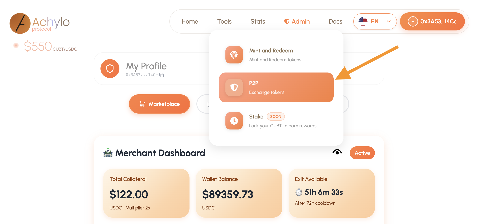

# Access and Initial Setup

### Available Network
* **Base Sepolia** (Until further notice).
* **Note:** Before sending USDC to your wallet, always verify the available network.

---

## How to Access the Achylo App

1.  **Access the official site:** Open [www.achylo.com](http://www.achylo.com) in your browser.
2.  **Connect your Wallet:** * Click the **“Connect”** button. 
    * If it's your first time, log in with your **preferred email**. A personalized wallet will be created automatically.
3.  **Receive Funds:** * Once the wallet is created, you're ready to receive **USDC** from other sources (exchanges or other wallets).
    * **IMPORTANT:** Make sure funds are sent exclusively through the **Base Network**.
4.  **Start Trading:** * With your wallet connected and funded, go to the menu: `Tools` -> `P2P`.
    * The app will display your address and unlock the main menus.

  

<strong>Img. No.1. P2P Path.</strong>

---

## Supported Fiat Currencies
The P2P Marketplace accepts multiple currencies to operate in different countries:

| Currency | Description |
| :--- | :--- |
| **APAY** | Achylo Governance Token |
| **CUP** | Cuban Peso |
| **MLC** | Freely Convertible Currency |
| **USD_CLASICA** | USD “classic” modality (transfers) |
| **USD** | United States Dollar |
| **COP** | Colombian Peso  |
| **EURO** | Euro  |
| **GBP** | British Pound |
| **CAD** | Canadian Dollar |
| **MXN** | Mexican Peso |
| **BRL** | Brazilian Real |
| **PEN** | Peruvian Sol |
| **DOP** | Dominican Peso |
| **PYG** | Paraguayan Guaraní  |
| **ECS** | Ecuadorian Sucre |
| **BOB** | Bolivian Boliviano |
| **ARS** | Argentine Peso |
| **VES** | Venezuelan Bolívar |